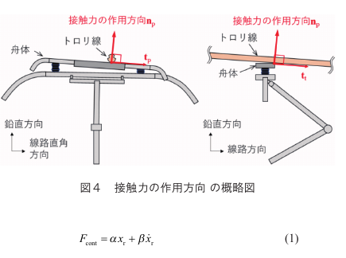
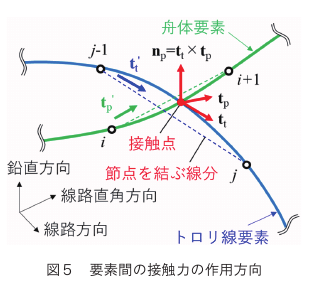
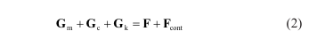
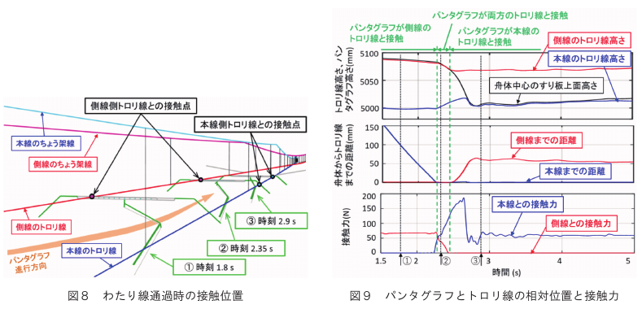
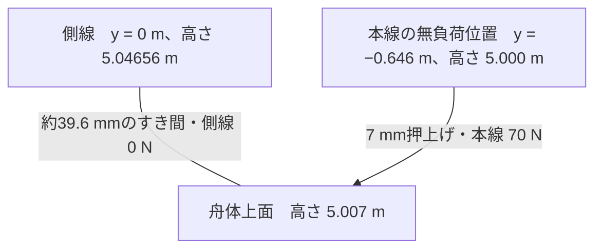
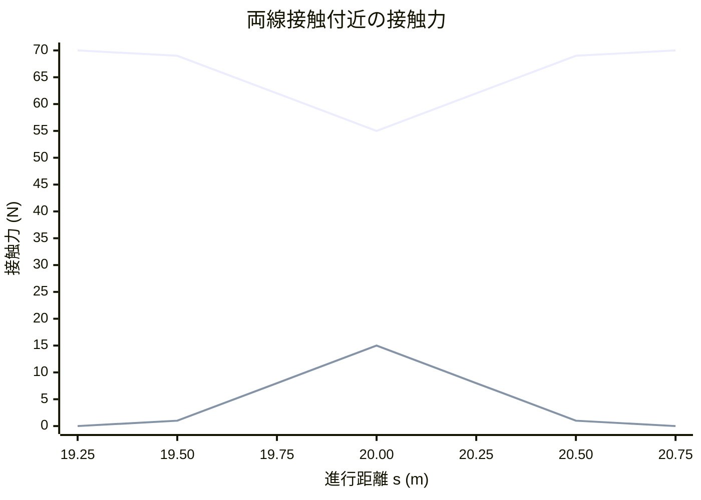

# 架線・パンタグラフ接触シミュレーション

出典: 小山達弥・長尾恭平・池田充 (2020 )「架線・パンタグラフの三次元シミュレーション」『鉄道総研報告』34巻9号、pp.5–10 [論文PDF](https://bunken.rtri.or.jp/doc/fileDown.jsp?RairacID=0001004688)

実行スクリプト: [simulate_catenary_crossing.py](working/simulate_catenary_crossing.py)  
入力: 合成データ [synthetic_catenary_crossing.csv](input/synthetic_catenary_crossing.csv)  
出力: [contact_results.csv](output/contact_results.csv)

## 1. 計算の目的と論文との対応
                                              
本コードは、側線側と本線側のトロリ線が近接するわたり区間を模した合成データから、舟体の高さ、各線との接触位置、接触力の配分を求める準静的デモです。**押上力は入力値**となります。CSVに含まれるのは無負荷のトロリ線座標で、押上力や接触状態は含まれません。

| 論文の箇所 | 論文の方法 | デモでの扱い |
|---|---|---|
| 3.1節・式(1)・図4–5 (pp.7–8 ) | 要素を投影して接触点を探し、両接線の外積で力の方向を決める。相対変位と相対速度を使うペナルティ法で接触力を計算する | 同じ進行位置の断面で舟体幅を判定し、鉛直の片側ばねで反力を計算する。剛性はデモ用の有効剛性 |
| 3.2節・式(2) (p.8 ) | 押上力を外力として与え、接触力を含む運動方程式を解く。開始位置は着線時の静的釣り合いから求める | 慣性と減衰を省略し、各断面で鉛直方向の静的釣り合いを解く |
| 5節・図8–9 (pp.9–10 ) | 側線から本線へ進入する計算例で、各線との接触位置と接触力の時間変化を示す | 同種の出力を合成データで計算する。接触位置や波形の定量再現は対象外 |

### 論文の式・図とコードの対応

**3.1節の式(1)と図4・5 (pp.7–8 )** では、両要素の長手方向に直交する接触力の方向を定め、その方向の相対変位と相対速度から力を求める。デモでは、この方向を鉛直に固定し、相対速度に依存する減衰項を省いている。幅による候補選定は `simulate()`、鉛直反力に基づく舟体高さの計算は `equilibrium()` に対応する。





**3.2節の式(2) (p.8 )** では、パンタグラフの押上力を含む外力 $F$ と、架線・舟体間の接触力 $F_{\mathrm{cont}}$ を区別する。デモの $P=70$ N は外力のうち鉛直方向の押上力に相当し、各線の接触力は釣り合いから求まる。



**5節の図8・9 (p.9 )** は、論文の計算条件で、わたり線通過時の接触位置と接触力の時間変化を示す。デモの出力列 `*_contact_y_m`、`*_contact_z_m`、`*_force_n` はこれらに対応する。下記の第4節に示すグラフは合成データの準静的な計算結果である。



*画像の出典はいずれも小山・長尾・池田 (2020 )の上掲論文である。画像内の式番号・図番号は論文の番号*

## 2. 入力と実行方法

`s_m` は進行方向の位置、`side_y_m` と `main_y_m` は側線側・本線側トロリ線の横位置、`side_z_m` と `main_z_m` は各線の無負荷高さである。単位はすべて m である。合成CSVは 0、10、20、30、40 m の5点を持つ。入力には有限な数値を使い、`s_m` を狭義昇順に並べた行が2行以上必要である。

2ファイルを同じフォルダに置いて実行する。Python標準ライブラリだけで動作する。

```bash
python simulate_catenary_crossing.py synthetic_catenary_crossing.csv --output contact_results.csv
```

| 引数 | 既定値 | 意味 |
|---|---:|---|
| `--speed-kmh` | 30 km/h | 距離を経過時刻に換算する速度 |
| `--step-m` | 0.05 m | 計算する断面の間隔 |
| `--half-width-m` | 0.65 m | 舟体の有効半幅 |
| `--push-force-n` | 70 N | 舟体に与える上向きの押上力 |
| `--stiffness-n-per-m` | 10,000 N/m | 各線に共通の鉛直方向の有効剛性 |

## 3. 実装の流れ

1. **`read_profiles()`** がCSVを読み込み、列名・数値・距離順を検証する。
2. **`simulate()` と `interpolate()`** が始点から終点まで断面を取り、隣り合うCSV行の座標を線形補間する。時刻は始点からの距離を速度 (m/s )で割って求める。既定のモデルでは速度を変えても距離に対する接触力は同じである。
3. **`simulate()`** が横位置の絶対値が舟体半幅以下の線を接触候補にする。舟体は横位置ゼロを中心とする水平な線分で、進行方向に直交する。
4. **`equilibrium()`** が押上力と接触反力の合計が釣り合う舟体高さを求める。
5. **`simulate()` と `main()`** が接触力・接触座標・状態をCSVに出力し、状態が変わった距離と時刻を標準出力に表示する。

### 鉛直方向の力の釣り合い

固定した断面 $s$ における接触候補の集合を $C(s)$ とし、舟体半幅を $w$ とする。舟体高さを $h$、トロリ線の無負荷高さを $z_i(s)$、有効剛性を $k$、押上力を $P$ とすると、接触判定と力の釣り合いは次式で表される。

$$
\begin{aligned}
C(s)&=\{i\in\{\mathrm{side},\mathrm{main}\}: |y_i(s)|\le w\},\\
F_i(s)&=
\begin{cases}
k\max(0,h-z_i(s)), & i\in C(s),\\
0, & i\notin C(s),
\end{cases}\\
F_{\mathrm{side}}(s)+F_{\mathrm{main}}(s)&=P \qquad (C(s)\ne\varnothing).
\end{aligned}
$$

候補線の高さを低い順に $z_1,z_2$ とすると、舟体高さは次式で得られる。

$$
h=
\begin{cases}
z_1+\frac{P}{k},
& \text{候補が1本、または } z_2-z_1 \geq \frac{P}{k},\\[6pt]
\frac{z_1+z_2+P/k}{2},
& \text{候補が2本かつ } z_2-z_1 \lt \frac{P}{k}.
\end{cases}
$$

線は舟体から上向きに押され、舟体は下向きの反力を受ける。候補がない場合は舟体高さを空欄とし、接触力は両線ともゼロである。

出力では `time_s`、`s_m`、`head_z_m` に加え、各線の横位置・無負荷高さ・接触座標・力を記録する。接触点の進行位置は同じ行の `s_m`、接触高さは舟体高さである。接触力が $10^{-8}$ Nを超える線を接触中と扱い、`contact_state` を `side`・`main`・`both`・`none` のいずれかにする。

## 4. 合成データでの計算例

**12.40 m** では本線の横位置が −0.646 mとなり、幅の内側に入る。側線と本線の無負荷高さはそれぞれ 5.04656 mと5.000 mである。本線だけを7 mm押し上げると反力が70 Nになり、舟体は5.007 mで釣り合う。このとき側線とのすき間は約39.6 mmで、接触力は本線70 N、側線0 Nである。



*図1　12.40 m断面の高さ関係。舟体の有効範囲は横方向に −0.65〜＋0.65 m で、本線は左端から4 mm内側にある。*

**20.00 m** では両線とも横位置0 mで、本線5.000 m、側線5.004 mである。本線を4 mm押し上げるのに40 N要するため、70 Nの押上力では舟体が側線にも届く。舟体高さは5.0055 mとなり、本線55 N・側線15 Nで釣り合う。



*図2　既定条件での接触力。本線が上側の曲線、側線が下側の曲線である。0.05 m刻みの計算点から0.25 mごとに抜き出しており、20.00 mでは本線55 N、側線15 Nである。*

| 距離 | 経過時刻 | その地点からの接触状態 |
|---:|---:|---|
| 0.00 m | 0.000 s | 側線のみ |
| 12.40 m | 1.488 s | 本線のみ |
| 19.50 m | 2.340 s | 両線 |
| 20.55 m | 2.466 s | 本線のみ |

既定値での実行では、始点と終点を含む801地点すべてで、接触力の合計が浮動小数点誤差の範囲で70 Nになることを確認した。表の距離は0.05 m刻みで状態の変化を最初に観測した点である。

## 5. 適用範囲

三次元座標はトロリ線の配置と接触位置の表現に使う。力学は鉛直方向の準静的な釣り合いに簡略化している。舟体の慣性・減衰・回転、架線の分布質量、波の伝播、実際の端部形状はモデルの対象外である。特に12.40 mの急な荷重移行は、舟体の端で接触候補を切り替え、その点で直ちに静的釣り合いを求める仮定から生じる。論文のような乗り移り直後のピークや振動を比較するには、架線とパンタグラフの動特性を与え、運動方程式を時間積分する必要がある。
